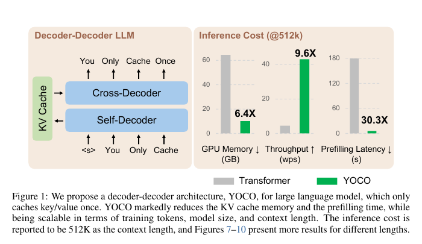
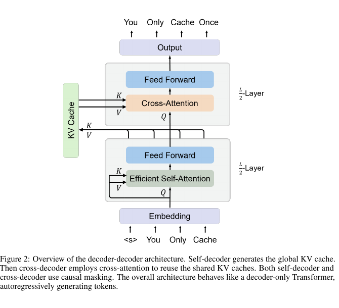
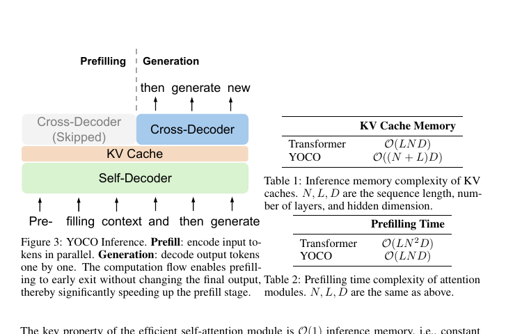
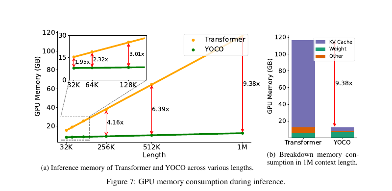

# YOCO：架构、发展与衍生体系

> 汇总时间：2026-11-08  
> 论文：*You Only Cache Once: Decoder-Decoder Architectures for Language Models*  
> 作者：Yutao Sun, Li Dong, Yi Zhu, Shaohan Huang, Wenhui Wang, Shuming Ma, Quanlu Zhang, Jianyong Wang, Furu Wei  
> arXiv:2405.05254；NeurIPS 2024  
> 代码：https://aka.ms/YOCO

---

## 0. 摘要

YOCO 要解决的是长上下文推理中的两个结构性成本：

```text
KV cache 随层数 × 序列长度增长
prefill 随序列长度呈二次增长
```

它提出的方案是：

```text
把模型拆成 self-decoder 和 cross-decoder
self-decoder 只生成一份 global KV
cross-decoder 所有层共享这份 KV
prefill 只跑 self-decoder，提前退出
```

原始 YOCO 没有被原样产品化，但它的核心思想在 2026 年进入多个模型：

```text
DeepSeek-V4.1-Flash 的 CED
```

同时，研究线沿着以下方向继续改造 YOCO：

```text
深度/容量：YOCO-U、YOCO++
KV 表达：CED 的逐层 KV projection
Sparse routing：CLSA / YOIO
```

---

# 第一部分：YOCO 架构介绍

## 1.1 问题背景

论文首先指出 decoder-only Transformer 的 KV cache 成本：

> “For the example of a 65B-size language model (augmented with grouped-query attention and 8-bit KV quantization), 512K tokens occupy about 86GB GPU memory, which is even larger than the capacity of one H100-80GB GPU.”

以及 prefill 成本：

> “Using four H100 GPUs, the 7B language model... requires about 110 seconds to prefill 450K tokens, and 380 seconds for 1M length.”

这两个数字分别对应：

```text
显存瓶颈：KV cache
计算瓶颈：prefill
```

YOCO 的目标不是单纯压缩 KV，而是从**层维度**重构 KV 的生成和复用方式。

---

## 1.2 总体架构



**Figure 1 原文图注：**

> “We propose a decoder-decoder architecture, YOCO, for large language model, which only caches key/value once. YOCO markedly reduces the KV cache memory and the prefilling time...”

图 1 左侧是 YOCO 的基本结构：

```text
输入
  -> Self-Decoder
  -> 生成 global KV cache
  -> Cross-Decoder
  -> 输出
```

右侧是 512K 上下文下的推理成本：

```text
GPU Memory        ↓ 约 6.4×
Throughput        ↑ 约 9.6×
Prefilling Latency↓ 约 30.3×
```

这里要注意方向：

```text
显存和延迟是下降
吞吐是上升
```

---

## 1.3 self-decoder / cross-decoder



**Figure 2 原文图注：**

> “Self-decoder generates the global KV cache. Then cross-decoder employs cross-attention to reuse the shared KV caches. Both self-decoder and cross-decoder use causal masking. The overall architecture behaves like a decoder-only Transformer, autoregressively generating tokens.”

论文把 L 层分成两半：

```text
前 L/2 层：self-decoder
后 L/2 层：cross-decoder
```

### Self-Decoder

self-decoder 的目标不是生成每层独立的 KV，而是生成一份**全局 KV**：

```text
X^{L/2} = Self-Decoder(X^0)
K̂ = LN(X^{L/2}) W_K
V̂ = LN(X^{L/2}) W_V
```

self-decoder 的每一层仍然是标准结构：

```text
Y^l = ESA(LN(X^l)) + X^l
X^{l+1} = SwiGLU(LN(Y^l)) + Y^l
```

其中 `ESA` 是 efficient self-attention。

论文的关键要求是：

> “The key property of the efficient self-attention module is O(1) inference memory, i.e., constant number of KV caches.”

也就是说，self-decoder 的缓存不能随序列长度增长。

论文使用两种实现：

- **gated retention（gRet）**：默认选择；
- **sliding-window attention（SWA）**：备选。

### Cross-Decoder

cross-decoder 的所有层共享同一份 `K̂, V̂`：

```text
Q̂^l = LN(X^l) W_Q^l
Y^l = Attention(Q̂^l, K̂, V̂) + X^l
X^{l+1} = SwiGLU(LN(Y^l)) + Y^l
```

> “The KV caches K̂, V̂ are reused by all the L/2 cross-decoder modules.”

因为所有层读取同一份 KV：

```text
不再需要每个 cross-decoder 层各存一份历史 K/V
```

---

## 1.4 Prefill 提前退出



**Figure 3 原文图注：**

> “Prefill: encode input tokens in parallel. Generation: decode output tokens one by one. The computation flow enables prefilling to early exit without changing the final output, thereby significantly speeding up the prefill stage.”

图中的关键部分是：

```text
Cross-Decoder (Skipped)
```

prefill 时：

```text
输入 -> Self-Decoder -> global KV
     -> 直接返回
     -> 不进入 Cross-Decoder
```

generation 时：

```text
新 token -> Cross-Decoder
         -> 读取 global KV
         -> 逐 token 生成
```

### 论文的复杂度分析：

| | KV Cache Memory | Prefilling Time |
|---|---|---|
| Transformer | `O(LND)` | `O(LN²D)` |
| YOCO | `O((N+L)D)` | `O(LND)` |

其中：

```text
N = 序列长度
L = 层数
D = hidden dimension
```
#### 显存复杂度

论文 Table 1：

| | KV Cache Memory |
|---|---|
| Transformer | `O(LND)` |
| YOCO | `O((N+CL)D)` |

其中 `N` 是序列长度，`L` 是层数，`D` 是 hidden dimension，C为常数

> “Because global KV caches are reused and efficient self-attention needs constant caches, the number of caches is O(N + CL), where N is the input length, C is a constant... For long sequences, CL is much smaller than N, so about O(N) caches are required, i.e., you only cache once.”

导读：

```text
Transformer：每层都存 N 个 K/V → O(LN)
YOCO：全局只存一份 N，加上 self-decoder 的常数缓存 → O(N + CL)
```

因此论文说：

> “YOCO roughly saves L times GPU memory for caches compared to Transformer decoders.”

#### Prefilling time复杂度计算

Table 2：

| | Prefilling Time |
|---|---|
| Transformer | `O(LN²D)` |
| YOCO | `O(LND)` |

如何算得：

对于 Self-attention

~~~text
Q 的维度 是 N x D
K 的维度 是 N x D
V 的维度 是 N x D
每个与之对应权重矩阵W（D x D)相乘，结果为 N x D，其中每个元素需要做D次相乘，故需要 O(ND^2)的复杂度 
后续Q与K的转置相乘结果为N x N，同样每个元素需要做D次相乘，复杂度为O(N^2 D)，再同V相乘，结果为 N x D ，每个元素需要做N次相乘，复杂度为 O(N^2 D)，考虑到每层都需要进行运算，结果为O(L N^2 D)
~~~

对于 SWA

~~~text
Q 的维度 是 N x D
K 的维度 是 C x D
V 的维度 是 C x D

Q与K的转置相乘结果为N x C，同样每个元素需要做D次相乘，复杂度为O(NCD)
再同V相乘，结果为 N x D ，每个元素需要做C次相乘，复杂度为O(NCD)，考虑L/2层，省去常数，保留O(L N D)
~~~

对于 Gated Retention
公式：


~~~text
对每个token
Q 的维度 是 1 x dk
K 的维度 是 1 x dk
V 的维度 是 1 x dv

KV做矩阵乘法，复杂度是O(dk*dv)
计算Ot ，复杂度也是O(dk*dv)
考虑N个token与L/2层，并约去常数
复杂度是O(L*N*dk*dv)
~~~


---

## 1.5 原始论文的主要结果

论文报告的关键数字：

```text
65B 模型 KV cache：约 80× 降低
3B 模型整体显存：32K 约 2× 降低
3B 模型整体显存：1M 约 >9× 降低
prefill：1M 约 71.8× 加速
prefill：32K 约 2.87× 加速
512K prefill：180 s -> <6 s
```



**Figure 7 原文图注：**

> “GPU memory consumption during inference.”

图中：

- 1M 上下文下 YOCO 整体显存约 `12.4GB`；
- Transformer 约为 YOCO 的 `9.38×`；
- 32K 下 YOCO 仍约省 `2×`。

---

## 1.6 “only cache once” 的严格含义

论文脚注明确限定：

> “The word ‘once’ refers to global KV cache. Strictly, self-decoder also needs to store a certain number of caches. As the self-decoder utilizes an efficient attention module, the cache size is bounded to a constant, which can be ignored compared to global caches when the sequence length is large.”

因此准确表述是：

```text
“only cache once” = global KV cache 只存一份
不是所有 cache 都为零
self-decoder 仍然有缓存（高效attention如SWA）
```

---

# 第二部分：发展与应用

## 2.1 发展时间线

| 时间 | 事件 | 意义 |
|---|---|---|
| 2024-05 | YOCO 论文发布 | 提出 decoder-decoder / 共享 global KV |
| 2024 | NeurIPS 2024 | 学术认可 |
| 2024–2025 | 代码公开，无官方 checkpoint | 社区难以直接复现 |
| 2026-04 | YOCO-U | 用递归提升 depth scaling |
| 2026-04 | YOCO++ | KV residual connection |
| 2026-06 | CLSA / YOIO | 共享 sparse routing index |
| 2026-09 | DeepSeek-V4.1-Flash | CED，明确 inspired by YOCO，权重开放 |
| 2026-11 | 当前状态 | YOCO 从论文架构变成设计模式 |

发展概况可以概括为：

```text
2024：提出
2025：研究引用，无产品
2026：长上下文 agent 需求爆发，进入生产模型
```

---

## 2.2 生产模型中的采用

### 2.2.1 DeepSeek-V4.1-Flash：CED

论文：

- [DeepSeek-V4.1-Flash](https://arxiv.org/abs/2609.19969)
- 2026-09-17

原文：

> “We adopt a Causal Encoder-Decoder (CED) architecture...”
>
> “CED architecture, inspired by YOCO...”

结构：

```text
40 层
前 20 层：causal encoder
后 20 层：decoder
```


原始架构图


根据技术报告
其中reuse的CSA2会复用FULL的Main KV、Indexer K 和 Top-K，reindex层会复用FULL的Main KV、Indexer K但是会自主计算Top-k

与原始 YOCO 的差异：

| 维度 | YOCO | CED |
|---|---|---|
| 层划分 | self / cross | encoder / decoder |
| global KV | 一份共享 K/V | 每层独立投影 |
| SWA | self-decoder 内部 | 仍逐层计算 |
| prefill | 跳过 cross-decoder | 跳过 decoder |
| 额外技术 | 无 | CSA2、FP4、SWA Bounded Replay |

论文的 prefill 复杂度：

```text
O(NL) -> O(NL/2 + n_win × L/2) ≈ O(NL/2)
```

SWA 部分：

```text
global KV 可以共享
local SWA KV 不能简单共享
-> SWA Bounded Replay
```

模型规模：

```text
552B backbone
196B Engram
prefill 激活 8B
decode 激活 16B
1M context
```

权重：

- [deepseek-ai/DeepSeek-V4.1-Flash](https://huggingface.co/deepseek-ai/DeepSeek-V4.1-Flash)

这是目前最有影响力的 YOCO 衍生落地。

---

## 2.3 研究线的改良与衍生

### 2.3.1 YOCO-U：递归 self-decoder

论文：

- [Universal YOCO for Efficient Depth Scaling](https://arxiv.org/abs/2604.01220)
- 2026-04-01

原文：

> “YOCO-U implements a Universal Self-Decoder that performs multiple iterations via parameter sharing, while confining the iterative process to shallow, efficient-attention layers.”

改动：

```text
原始 YOCO：self-decoder 跑一次
YOCO-U：self-decoder 参数共享，重复迭代多次
        但只在浅层、高效注意力层里迭代
```

目的：

```text
不增加 KV cache 的情况下
增加 representational depth
```

保留：

```text
constant global KV
linear prefill
```

---

### 2.3.2 YOCO++：KV residual connection

论文：

- [YOCO++](https://arxiv.org/abs/2604.13556)
- 2026-04-15

原文：

> “We propose YOCO++, an enhanced YOCO that incorporates a weighted residual connection between the KVs of each bottom-half layer and the bottom layer.”

改动：

```text
原始 YOCO：cross-decoder 读取最后一层 / 中间层 KV
YOCO++：bottom-half 每层 KV
        与 bottom layer KV 做 weighted residual
```

目的：

```text
增加容量
同时保持训练/推理效率
```

结果：

```text
50% KV compression rate 下
cross-layer KV compression 方法中 SOTA
并超过标准 Transformer
```

---

### 2.3.3 CLSA / YOIO：共享 sparse routing index

论文：

- [You Only Index Once](https://arxiv.org/abs/2606.06467)
- 2026-06-04

原文：

> “We propose cross-layer sparse attention (CLSA), which is built on top of KV-sharing architectures such as YOCO. The core idea is to share not only the KV cache across cross-decoder layers, but also the routing index.”

改动：

```text
原始 YOCO：共享 KV
CLSA：共享 KV + 共享 top-k routing index
```

做法：

```text
一个 indexer 计算 token-level top-k
所有 cross-decoder 层复用这个 index
```

结果：

```text
128K context
最高 7.6× decoding speedup
17.1× overall throughput improvement
```

---

### 2.3.4 CED：逐层 KV 投影

CED 是 DeepSeek V4.1 的生产化改造，前面已展开。

它的研究意义是：

```text
从“所有层共享同一份 KV”
推进到
“所有层共享 encoder hidden state，但各自投影 KV”
```

这解决了共享 KV 的表达能力瓶颈。

---

## 2.4 衍生路线对比

| 架构 | 核心改动 | 与 YOCO 的关系 | 主要收益 | 主要代价 |
|---|---|---|---|---|
| YOCO | self/cross + 共享 global KV | 原始 | KV O(N)，prefill 提前退出 | 共享 KV 容量受限 |
| YOCO-U | self-decoder 递归 | 补深度 | depth scaling | 递归训练复杂 |
| YOCO++ | KV residual | 补容量 | 50% 压缩下质量更好 | 额外 residual 结构 |
| CLSA/YOIO | 共享 routing index | 补 routing | decode/throughput 提升 | index 共享精度折中 |
| CED | 逐层 KV projection | 生产化改造 | 表达更强，prefill 减半 | 每层额外投影 |

---

## 2.5 研究趋势归纳

YOCO 的演进可以归纳为四条主线：

### A. 容量与深度

```text
YOCO-U：递归
YOCO++：KV residual
```

解决的问题：

```text
共享 KV 后，模型容量/深度不足
```

### B. KV 表达

```text
CED：每层独立 KV projection
```

解决的问题：

```text
所有层共用一份 K/V，层间差异丢失
```

### C. Sparse routing

```text
CLSA / YOIO：共享 index
```

解决的问题：

```text
共享 KV 后，routing 仍然逐层重复
```

### D. 与 SWA / serving 结合

```text
CED：SWA Bounded Replay
```

解决的问题：

```text
local SWA 不能简单共享
prefill/decode 系统调度复杂
```

---

## 3. 结论

### 3.1 YOCO 的角色

```text
原始 YOCO：
  证明“global KV 只存一次”可行

后续：
  把 YOCO 拆成可独立替换的部件
  - global KV 共享
  - KV projection
  - routing index
  - SWA
  - cache precision
```

### 3.2 采用情况

```text
原版 YOCO：没有官方权重，未产品化
DeepSeek-V4.1-Flash：CED，已发布权重
```

### 3.3 一句话

> **YOCO 没有作为一个模型流行起来，但作为一个架构模式，它已经进入 2026 年的长上下文生产模型。**

---

## 参考链接

### 原始论文与代码

- [YOCO 论文](https://arxiv.org/abs/2405.05254)
- [官方代码](https://github.com/microsoft/unilm/tree/master/YOCO)
- [NeurIPS 2024](https://proceedings.neurips.cc/paper_files/paper/2024/hash/0df38cd13520747e1e64e5b123a78ef8-Abstract-Conference.html)

### 生产模型

- [DeepSeek-V4.1-Flash 论文](https://arxiv.org/abs/2609.19969)
- [DeepSeek-V4.1-Flash 权重](https://huggingface.co/deepseek-ai/DeepSeek-V4.1-Flash)

### 研究衍生

- [YOCO-U](https://arxiv.org/abs/2604.01220)
- [YOCO++](https://arxiv.org/abs/2604.13556)
- [CLSA / YOIO](https://arxiv.org/abs/2606.06467)
- [Hidden Decoding at Scale](https://arxiv.org/abs/2607.08186)

### 社区分析

- [青稞社区：YOCO 及衍生变种](https://qingkeai.online/blog/YOCO)
- [知乎：如何评价 YOCO](https://www.zhihu.com/question/655712946)
